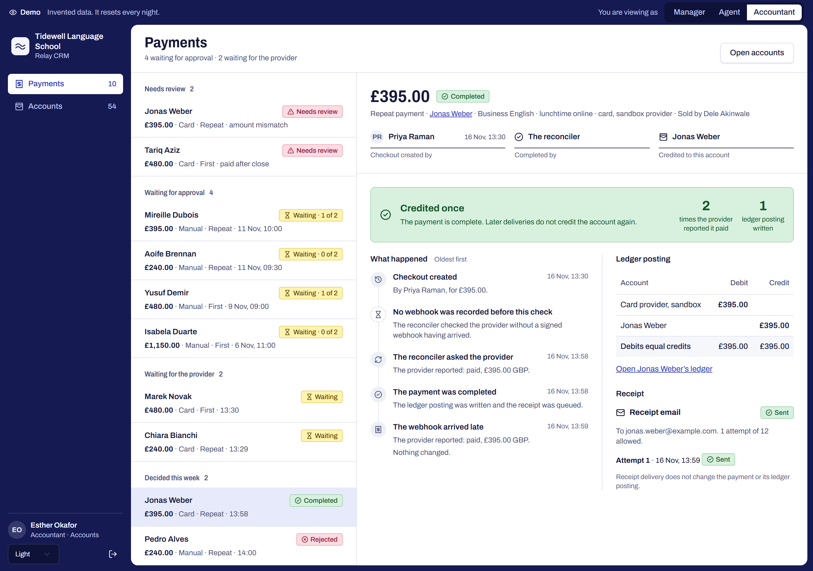

# Relay CRM

<picture>
  <source media="(prefers-color-scheme: dark)" srcset="docs/images/queue-dark.png">
  
</picture>

Relay CRM is a sales CRM for a small team that buys leads from ads and closes them by phone. Leads arrive from Meta Lead Ads, a web form or a CSV file. A manager shares them out, each agent works a queue of callbacks, and payments are recorded and posted to a ledger. Manual payments need approval from two people. It is a complete product that runs with one command, with invented data and three roles to try.

## Run it

With Docker and Docker Compose installed, run this in the repository.

```sh
docker compose up
```

Wait for the app to become healthy, then open [Relay CRM](http://127.0.0.1:3107). Choose **Manager** for Priya, **Agent** for Dele or **Accountant** for Esther. The [mail inbox](http://127.0.0.1:8127) holds sign-in codes and receipts.

Measure first-run time with `pnpm demo:check ../relay-demo-evidence --cold` and image sizes with `docker image inspect`. The [demo guide](docs/demo.md) gives the full measurement commands, hosting settings and cleanup steps.

## Three things to try

1. As Manager, select leads in **Lead pool**, choose **Round-robin**, press **Preview** and then **Assign** to see each owner before anything moves.
2. Switch to Agent, open **Hye-jin Park**, log **Spoke to them** with a note, then **Close lead** and **Won** to see the lead leave the queue and an account open.

<picture>
  <source media="(prefers-color-scheme: dark)" srcset="docs/images/pool-dark.png">
  
</picture>

3. As Agent, open **Accounts**, **Leila Farouk** and **Create card checkout**, enter **395.00**, create it, open the sandbox page, choose **Drop it** and pay, then return to the payment and watch the reconciler complete it with one ledger posting.

<picture>
  <source media="(prefers-color-scheme: dark)" srcset="docs/images/payment-dark.png">
  
</picture>

## How it is built

TypeScript, Next.js, React, tRPC, TanStack Query, Prisma and PostgreSQL, packaged with Docker Compose.

| Package           | Owns                                | Must not do                           |
| ----------------- | ----------------------------------- | ------------------------------------- |
| `packages/domain` | Pure product rules                  | Import dependencies or read the clock |
| `packages/store`  | Every SQL statement and transaction | Export the database client            |
| `apps/web`        | HTTP and screens                    | Import a database client              |

## What is proven, and where

- Concurrent submissions become one lead. [Intake race](packages/store/test/intake-races.int.test.ts), `for one new email: one lead is created and the other attaches to it`. Run `pnpm test:int -- packages/store/test/intake-races.int.test.ts`.
- One scope function decides reads, edits and assignments. [Access](packages/domain/test/access.test.ts), `never lets a $role in $situation edit a lead they cannot read`. Run `pnpm test -- packages/domain/test/access.test.ts`.
- A payment credits once across duplicate, late or missing webhooks. [Payment races](packages/store/test/payments.int.test.ts), `a webhook, its duplicate and the reconciler collide and credit exactly once` and `a lost webhook is reconciled and a late webhook changes no money or audit`. Run `pnpm test:int -- packages/store/test/payments.int.test.ts`.
- Manual payments need two approvers who did not set the terms. [Manual payments](packages/store/test/manual-payments.int.test.ts), `the last editor is a maker and editing voids existing approvals`. Run `pnpm test:int -- packages/store/test/manual-payments.int.test.ts`.
- The app's database role cannot change a ledger line. [Database role](packages/store/test/database-role.int.test.ts), `the app role refuses UPDATE ledger_lines SET amount=amount+1`. Run `pnpm test:int -- packages/store/test/database-role.int.test.ts`.
- Every open lead appears in exactly one queue group. [Queue partition](packages/domain/test/work.test.ts), `open leads match an independent partition across offsets, DST changes and midnight`. Run `pnpm test -- packages/domain/test/work.test.ts`.

## Limits

v0.1 has no payment reversal, task system, audit viewer or general email connector. The payment provider is a sandbox inside the app and moves no real money. Demo logins are shared, so one visitor can act as both approvers. Read the [full limits](docs/limits.md) before using it beyond the demo.

[Demo and hosting](docs/demo.md) · [Payments](docs/payments.md) · [Access and security](docs/access-security.md) · [API](docs/api.md) · [Intake](docs/intake.md) · [Development](docs/development.md) · [MIT licence](LICENSE)
