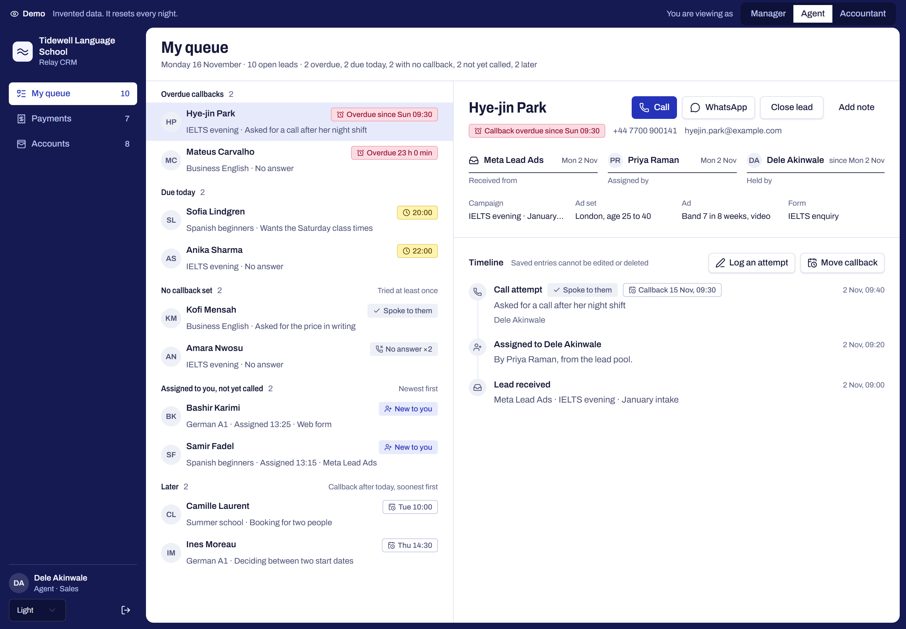
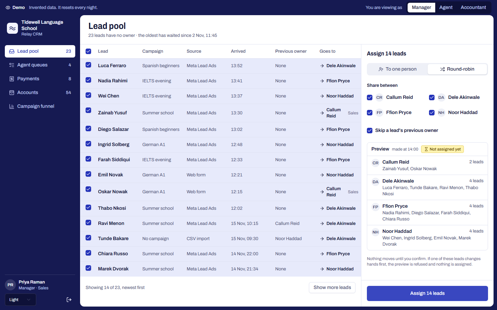

# Relay CRM

<picture>
  <source media="(prefers-color-scheme: dark)" srcset="docs/images/queue-dark.png">
  
</picture>

Relay CRM is a sales CRM for a small team that buys leads from ads and closes them by phone. Leads arrive from Meta Lead Ads, a web form or a CSV file. A manager shares them out, each agent works a queue of callbacks, and payments are recorded and posted to a ledger. Manual payments need approval from two people. It runs with one command, on invented data, and you can try it as the manager, the agent or the accountant.

It is built with TypeScript, Next.js, React, tRPC, TanStack Query, Prisma and PostgreSQL.

## Run it

With Docker and Docker Compose installed, run this in the repository.

```sh
docker compose up
```

Wait for the app to become healthy, then open [Relay CRM](http://127.0.0.1:3107). The sign-in page has a button for each of three people: Priya Raman the manager, Dele Akinwale the agent and Esther Okafor the accountant. The [mail inbox](http://127.0.0.1:8127) shows the receipts the demo sends, and the code if you sign in by email.

A first run builds the app image, taking about two and a half minutes and about 4.2 GB of images, excluding the time to download the base images. The [first-run measurements](docs/demo.md#first-run-measurements) give the exact figures and the commands that produced them.

## Three things to try

1. As **Manager**, open **Lead pool**, select two leads, and choose **Round-robin**. Press **Preview 2 leads** to see each owner, then **Assign 2 leads**.
2. Switch to **Agent**, open **Hye-jin Park**, press **Log an attempt**, choose **Spoke to them**, enter a **Note**, and press **Save attempt**. Press **Close lead**, choose **Won**, then press **Close as won** to open an account.

<picture>
  <source media="(prefers-color-scheme: dark)" srcset="docs/images/pool-dark.png">
  
</picture>

3. As **Agent**, open **Accounts**, **Leila Farouk**, and **Create card checkout**, enter **395.00** in **Amount**, press **Create checkout**, then **Open the page**, choose **Drop it**, and press **Pay £395.00**. Return to the app's tab, switch to **Accountant**, open **Payments** and that payment, and wait about a minute for the scheduled reconciler to complete it with one ledger posting.

<picture>
  <source media="(prefers-color-scheme: dark)" srcset="docs/images/payment-dark.png">
  
</picture>

## How it is built

Three packages, each with one job and one thing it must not do. Docker Compose packages the demo.

| Package           | Owns                                | Must not do                           |
| ----------------- | ----------------------------------- | ------------------------------------- |
| `packages/domain` | Pure product rules                  | Import dependencies or read the clock |
| `packages/store`  | Every SQL statement and transaction | Export the database client            |
| `apps/web`        | HTTP and screens                    | Import a database client              |

## What is proven, and where

- Concurrent submissions become one lead. [Intake race](packages/store/test/intake-races.int.test.ts), `for one new email: one lead is created and the other attaches to it`. Run `pnpm exec dotenv -- vitest run --project integration packages/store/test/intake-races.int.test.ts`.
- Lead edit and assignment scope never exceed read scope. [Access](packages/domain/test/access.test.ts), `never lets a $role in $situation edit a lead they cannot read`, which runs once for every role and team situation. Run `pnpm exec vitest run --project unit packages/domain/test/access.test.ts`.
- A payment credits once across duplicate, late or missing webhooks. [Payment races](packages/store/test/payments.int.test.ts), `a webhook, its duplicate and the reconciler collide and credit exactly once` and `a lost webhook is reconciled and a late webhook changes no money or audit`. Run `pnpm exec dotenv -- vitest run --project integration packages/store/test/payments.int.test.ts`.
- Manual payments need two approvers who did not set the terms. [Manual payments](packages/store/test/manual-payments.int.test.ts), `the last editor is a maker and editing voids existing approvals`. Run `pnpm exec dotenv -- vitest run --project integration packages/store/test/manual-payments.int.test.ts`.
- The app's database role cannot change a ledger line. [Database role](packages/store/test/database-role.int.test.ts), `the app role refuses UPDATE ledger_lines SET amount=amount+1`. Run `pnpm exec dotenv -- vitest run --project integration packages/store/test/database-role.int.test.ts`.
- Every open lead appears in exactly one queue group. [Queue partition](packages/domain/test/work.test.ts), `open leads match an independent partition across offsets, DST changes and midnight`. Run `pnpm exec vitest run --project unit packages/domain/test/work.test.ts`.

## Limits

v0.1 has no payment reversal, task system, audit viewer or general email connector. The payment provider is a sandbox inside the app and moves no real money. Demo logins are shared, so one visitor can act as both approvers. Read the [full limits](docs/limits.md) before using it beyond the demo.

[Demo and hosting](docs/demo.md) · [Payments](docs/payments.md) · [Access and security](docs/access-security.md) · [API](docs/api.md) · [Intake](docs/intake.md) · [Development](docs/development.md) · [MIT licence](LICENSE)
