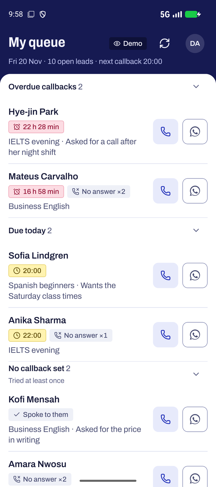
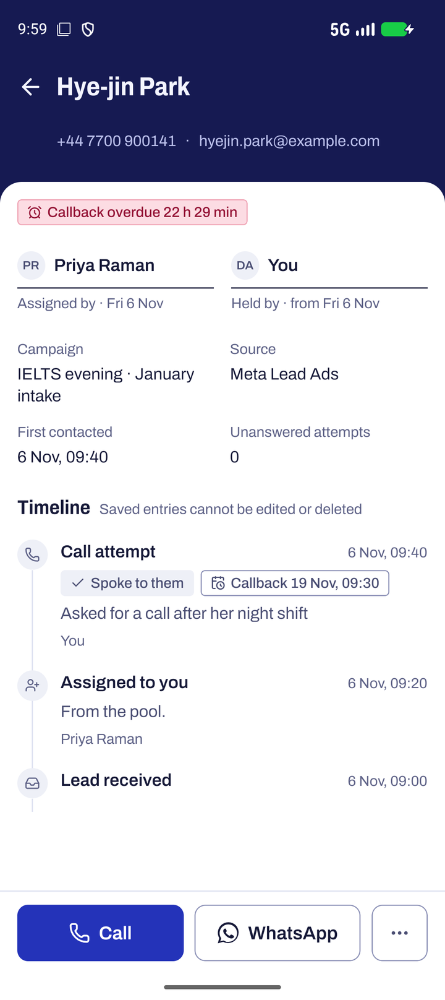
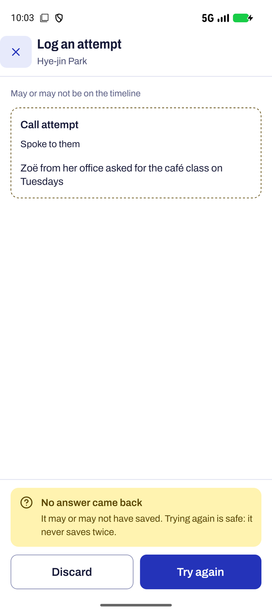
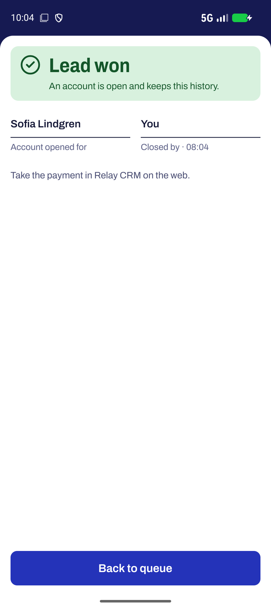

# Use Relay CRM on a phone

The app in `apps/mobile` is for sales agents. It reads your callback queue and lead history, logs attempts, adds notes, changes callbacks, and closes leads. Account shows your profile and teams. Teams do not change your queue.

<p>
  
  
  
  
</p>

The screenshots are from Expo Go on an Android emulator against the Docker demo.

## Run the app

Install Node.js 24.2 or later and the pnpm version in the root `package.json`. From the repository root, install the dependencies and generate the database client.

```sh
pnpm install --frozen-lockfile
pnpm db:generate
```

Use a running Relay CRM server. For a local server, follow the [development guide](development.md). The [Docker demo](../README.md#run-it) also accepts phone sessions. Its default port is 3107, and its default bind address accepts connections only from the host computer.

Set `EXPO_PUBLIC_RELAY_URL` to the server's origin before starting the app.

In a POSIX shell:

```sh
EXPO_PUBLIC_RELAY_URL=https://relay.example pnpm --filter @relay/mobile dev
```

In PowerShell:

```powershell
$env:EXPO_PUBLIC_RELAY_URL = "https://relay.example"
pnpm --filter @relay/mobile dev
```

Open the project in Expo Go. Both the development server and the Relay CRM server must be reachable from your phone. A physical phone needs a reachable HTTPS address or the computer's LAN address and a server bound to that interface. Android emulators can reach the host at `http://10.0.2.2:3107`. An iOS simulator can use `http://localhost:3107`.

The server origin is a build-time setting. A release without it fails at startup. Development alone defaults to the Android emulator address. HTTPS is required except for loopback and private network addresses. Demo access appears only after the server's public information read confirms that demo access is available.

## Sign in and remove phone data

Sign in with a code from your email. Sessions last up to 24 hours, have no refresh, and can end sooner. An authentication outage keeps the token and offers another check. A confirmed session end opens sign-in. Over an open write form, held entry, or won result, sign-in appears above that screen and preserves it when dismissed.

Signing in as the same person enables the kept form's actions. Nothing sends automatically. Signing in as another person opens their queue and hides the previous person's data. An ended session opened after a restart starts with a blank email and offers local removal.

Sign-out asks before removing your unresolved entries and drafts and names their counts. If the phone store could not load, it warns that an unknown number of kept items will be deleted. Sign-out first asks the server to revoke the session. Only a confirmed success or session-ended answer allows token removal, followed by erasing that person's phone data and clearing the in-memory queries. An unconfirmed sign-out deletes nothing.

**Remove sign-in from this phone** skips server revocation and has its own confirmation. The server session can remain open until it expires. If token removal fails, local data stays. If phone-data erasure fails after token removal, the app tells you that items are still on this phone. To retry, sign in as the same person, then sign out or remove sign-in again. Those items stay isolated from other people who sign in.

Entries and drafts are stored per server and person in the app's private SQLite database. SQLite's secure-delete setting overwrites deleted row content in the database file. The database is not encrypted beyond the platform's storage protection. Expo Go owns its per-project storage. Tokens and remembered sign-in addresses use secure platform storage. The app does not log your note text. Copy actions put the selected text on the system clipboard.

The queue is kept only in memory. A failed refresh can show an earlier queue from the current run with its age. Restarting requires a new queue read. There is no stored queue snapshot containing names, contact details, or last notes.

## Save a write and recover an uncertain answer

While you type, the app keeps a draft after 500 ms and writes pending drafts immediately when it leaves the foreground. Save stops that draft lifecycle. It stores the frozen payload and a unique key before sending anything. That storage step also removes the operation's draft. An entry awaiting review prevents another write or a new draft for the same lead. Drafts already kept for other operations remain available after the entry is resolved.

Phone storage has five seconds to confirm. If the initial store does not confirm, nothing is sent. The form stays editable and offers another try or copying your note. If the initial store lands late, typing replaces that entry with a draft. Discard removes it.

The app marks a write's outcome unknown after waiting 20 seconds for an answer. A network error, server error, proxy page, or malformed receipt also leaves the outcome unknown. Reads retain their own timeouts and cancellation.

Use the outcome shown on the entry to decide what to do.

| Outcome                     | What it means and what you can do                                                                                                                                                           |
| --------------------------- | ------------------------------------------------------------------------------------------------------------------------------------------------------------------------------------------- |
| Saved                       | A readable receipt confirms the operation. The app removes its copy and refreshes the lead and queue. If history cannot refresh, reload it. Do not submit another write to refresh history. |
| Storage failed              | The initial phone store did not confirm. Nothing was dispatched. Keep editing, copy your note, try again, or discard.                                                                       |
| Never submitted             | The system reported no connection before dispatch. Retry, edit, or discard the kept entry.                                                                                                  |
| Unknown                     | The request was dispatched without a usable answer. Retry with the same key, or explicitly discard the phone copy. Discard cannot undo a server save.                                       |
| Not saved after session end | The first send failed the server's session check before it could write. Sign in to retry, or return it to a draft after phone storage confirms the change.                                  |
| Refused                     | Review the kept copy or delete it. Correctable callback and closing refusals restore an editable draft only after storage confirms it.                                                      |
| Refused after unknown       | A retry was refused, but the earlier request may have saved. The entry stays locked and keeps that uncertainty visible.                                                                     |

Retries keep the original payload and key, so a repeated request cannot create a second activity. After a restart, a stored sending entry becomes unknown. The app does not send it automatically.

A receipt from any open attempt in the current session settles an entry that is still sending or unknown. Refusals and session-ended answers count only for the latest attempt. A receipt arriving while retry storage is pending waits for storage to settle and prevents another dispatch. Session end closes the session's open requests. Deleted entries and terminal refusals ignore late answers.

Entry review appears on the lead and queue. Failed status updates keep a storage warning and retry when the form opens again. If a saved entry's local deletion fails, **Clear it** retries deletion. Until that succeeds, a restart conservatively restores the remaining disk copy as unknown.

A key conflict means the key was used with different input. Review the kept copy beside the latest history, reload history, copy your note, or delete the copy. This recovery does not identify another request and offers no new dispatch.

## Calls, callbacks, and closing

Opening the dialler or a WhatsApp link makes no server write. With no held entry, the attempt form opens before the handoff. A successful handoff records its channel and time locally. Acceptance of a WhatsApp link does not prove a message was sent. With a held entry, the external link opens without another form. A failed handoff offers retry, copy, or call recovery.

Call links accept an optional plus and 7 to 15 digits after ordinary separators are removed. Short codes have no live Call control. A bracketed trunk zero after a country code is rejected. WhatsApp needs an explicit international number of 8 to 15 digits.

Callback times use the organisation's time zone from a successful queue read in the current run. Until then, callback inputs show Loading times and accept no new time. Pickers use the system calendar and wheels on iOS and system dialogs on Android.

**In 1 hour** uses the tap's instant and rounds upwards to five minutes. Other shortcuts use the organisation's wall clock. An accepted instant stays fixed on retry. A nonexistent wall time is rejected. A repeated wall time uses its earlier instant. The server still decides whether the submitted instant is in the future.

An attempt without a callback removes an existing callback. The form warns before saving. A future callback starts enabled with its current value. An overdue callback starts off. Clearing a callback already cleared on the server finishes without another mutation.

Closing requires an explicit outcome and a separate confirmation. The choice freezes during confirmation, whose accept button ignores presses for 400 ms. Back, backgrounding, and session end withdraw confirmation. A restored draft keeps the choice and reason but requires confirmation again. Won opens its receipt-based result once. Lost and dead return to the queue. There is no undo.

## Limits

Each queue group holds at most 100 leads. The app has no payments, account management, search, callback notifications, tablet layout, lead-contact editing, theme setting, or offline sign-in. Won results do not survive restart. A discarded unknown entry may already exist on the server. A phone that cannot confirm storage can lose the latest typed text when terminated. A refused retry stays uncertain, and a key conflict cannot be matched to another request.

After the 20-second deadline, the app keeps the request open for up to two minutes to accept a late answer. If the app closes the request at that limit, the outcome stays unknown and you can retry with the original key.

A suspended or terminated app may miss an answer. Expo Go owns its native manifest and calendar appearance, so some handoff schemes and picker colors need a dedicated native build to configure.

Archivo is bundled under its [SIL Open Font License](../apps/mobile/assets/fonts/OFL.txt). Text follows the system's size setting.
